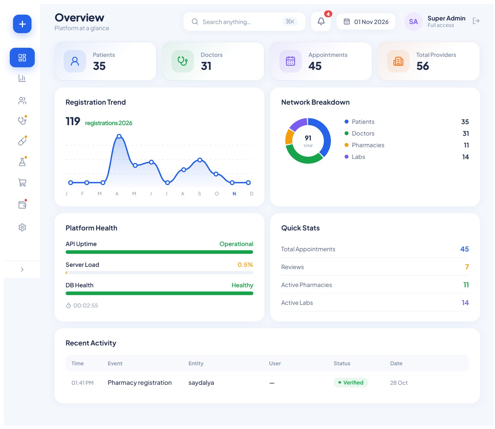
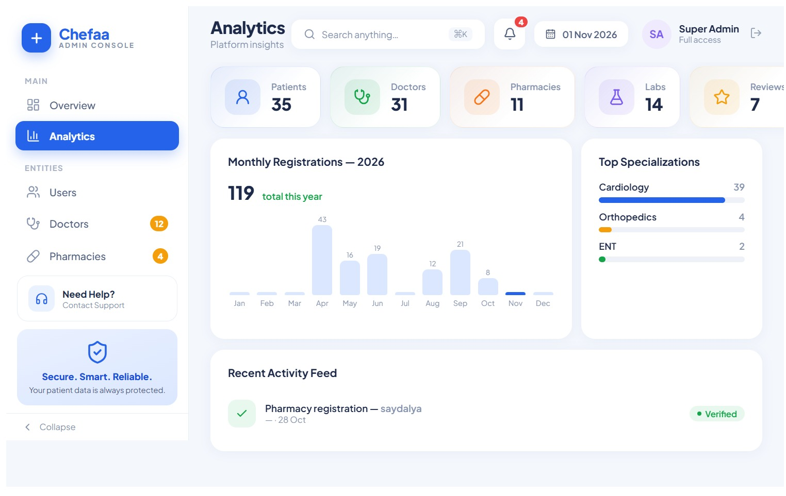
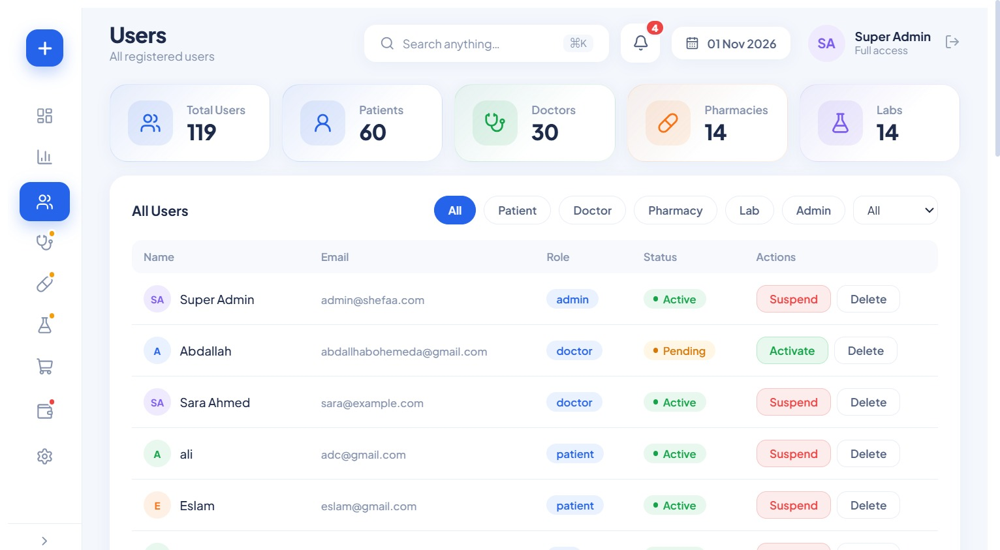
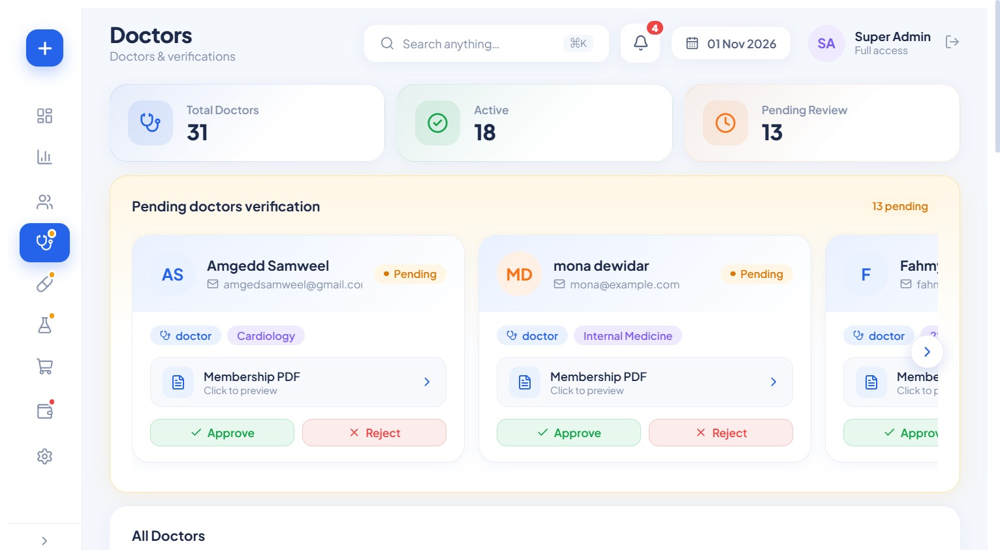
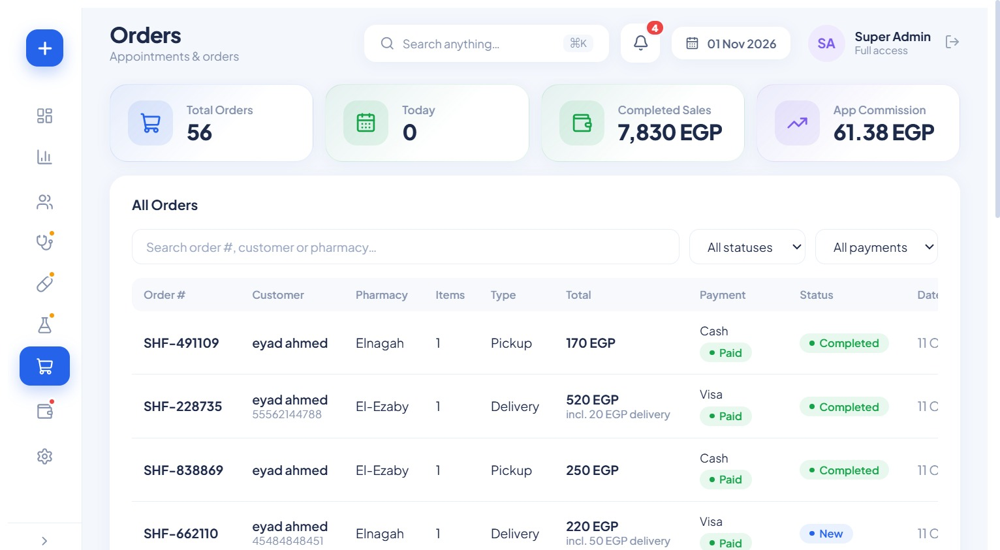
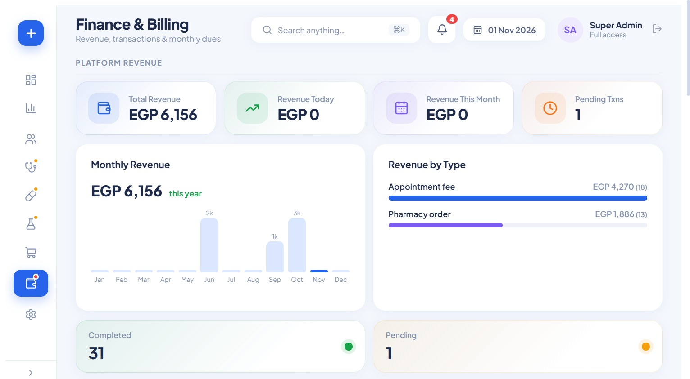
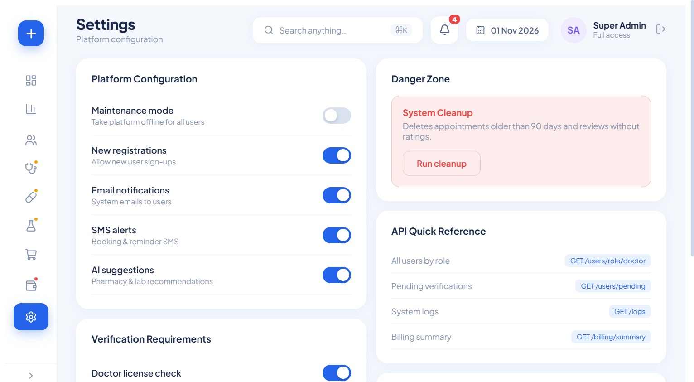

# Shefaa Admin Dashboard

A React admin dashboard for the Shefaa healthcare platform. It provides an interface for reviewing users and healthcare providers, monitoring platform activity, tracking orders, and viewing revenue and billing information.

This repository contains the admin frontend. It connects to the separate Shefaa backend API and is not the doctor, pharmacy, or lab portal.

## Screens

| Screen | Interface |
| --- | --- |
| Overview | Summary cards, registration trends, network breakdown, platform-health indicators, and recent activity |
| Analytics | Monthly registration charts, provider and patient counts, top specializations, and an activity feed |
| Users | User list with role and status filters, plus account-management controls |
| Doctors | Provider counts and verification cards with document-preview, approval, and rejection controls |
| Pharmacies | Pharmacy counts, pending verification cards, and a provider list |
| Labs | Lab counts, pending verification cards, and a provider list |
| Orders | Order list with search, status and payment filters, customer details, totals, and delivery or pickup information |
| Finance & Billing | Revenue summaries, monthly revenue, revenue by type, and transaction-status counts |
| Notifications | A notification menu for pending provider verification and overdue payments |
| Settings | Platform-configuration and verification switches, a cleanup control, and an API reference panel |
| Global Search | Search results with user roles and account statuses |
| Login | Admin sign-in interface |

## Technology

- React
- TanStack Query
- REST API integration
- Custom SVG charts

## Backend dependency

The frontend requires a running, compatible Shefaa backend and an authorized admin account for protected operations. The backend handles the server-side data and access checks.

## Local setup

Setup instructions will be added after checking this app's `package.json`, supported Node.js version, and API configuration. Do not assume the start command, port, or environment-variable name from another React project.

## Screenshots

### Overview

### Analytics

### Users

### Doctors

### Orders

### Finance

### Settings

## Scope

The screens above describe the dashboard interface. A visible control is not a claim that its backend workflow has been tested in every case. Platform-health cards are not an uptime guarantee, and the settings interface is not a claim of deployed AI functionality.